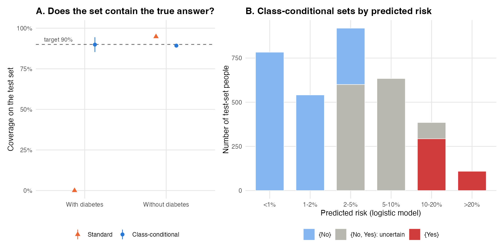

# How sure is the model? Predicting undiagnosed type 2 diabetes

A small learning project in R. I used NHANES 2013-2018 (11,240 US adults) to predict undiagnosed type 2 diabetes from simple health measures. I compared logistic regression, LASSO, random forest and XGBoost, and checked more than just accuracy: calibration, uncertainty (conformal prediction), fairness across groups, SHAP and decision curves.

**Report: [report/report.md](report/report.md)**



## Main findings

- All four models had an AUC of about 0.76-0.78. XGBoost and random forest were not better than logistic regression.
- Standard conformal prediction missed every person with diabetes, because the outcome is rare. The class-conditional version worked, and showed that the model can't tell for about 4 in 10 people.
- The model worked better for younger people (AUC 0.85) than for older people (about 0.70).
- Age, waist and HDL cholesterol were the most important predictors. XGBoost was poorly calibrated for Asian and White adults; logistic regression was fine in all groups.

## Files

```
R/             scripts, run in order (01 cleaning ... 08 decision curve)
data/raw/      data log; the NHANES files are downloaded by R/download_data.R
output/        result tables
figures/       figures
report/        the report
run_all.R      runs everything
```

## How to run

Install R and the packages, open `diabetes-risk-ml.Rproj` in RStudio and run `source("run_all.R")`:

```r
install.packages(c("haven", "dplyr", "tidyr", "ggplot2", "patchwork", "glmnet",
                   "ranger", "xgboost", "pROC", "survey", "scales"))
```

Data: NHANES, US National Center for Health Statistics, https://wwwn.cdc.gov/nchs/nhanes/

Tanvir Ahmed, MSc Statistical Data Analytics, Tampere University
