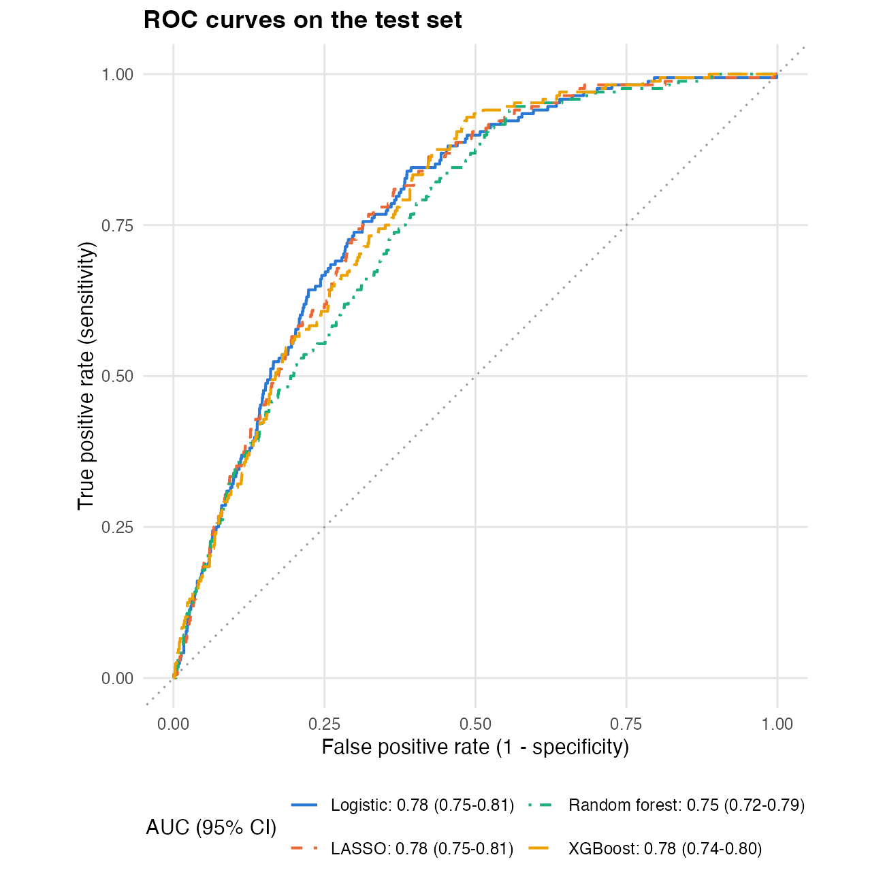
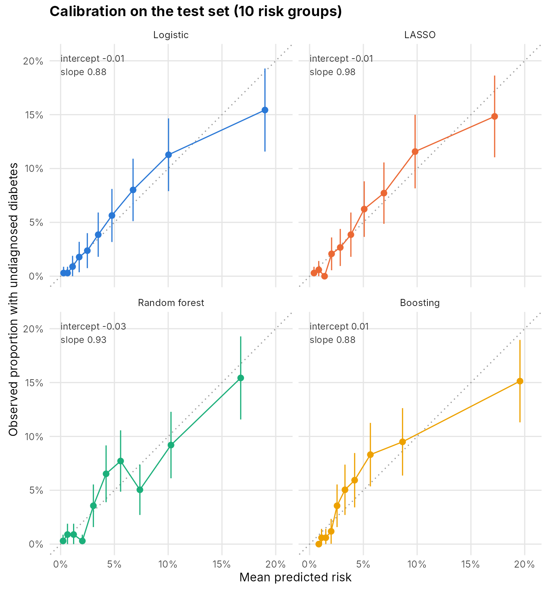
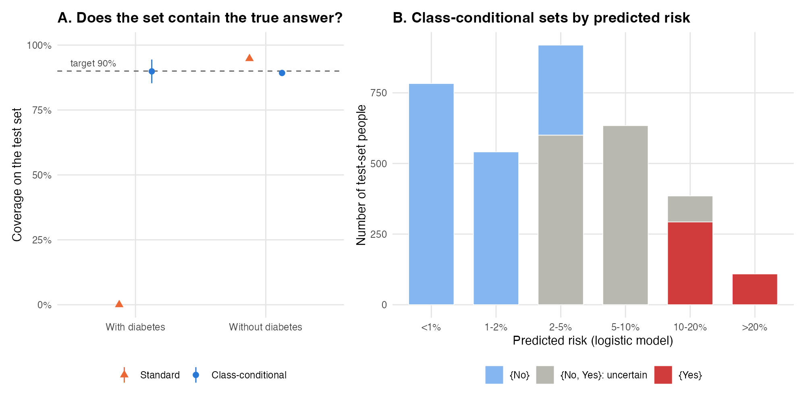
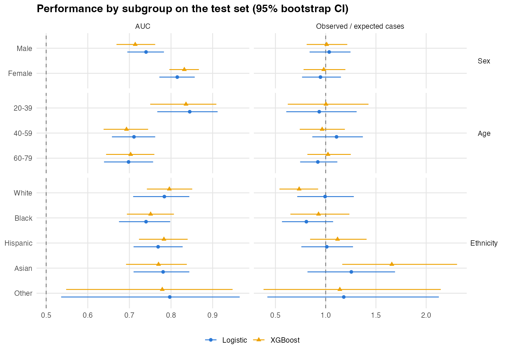
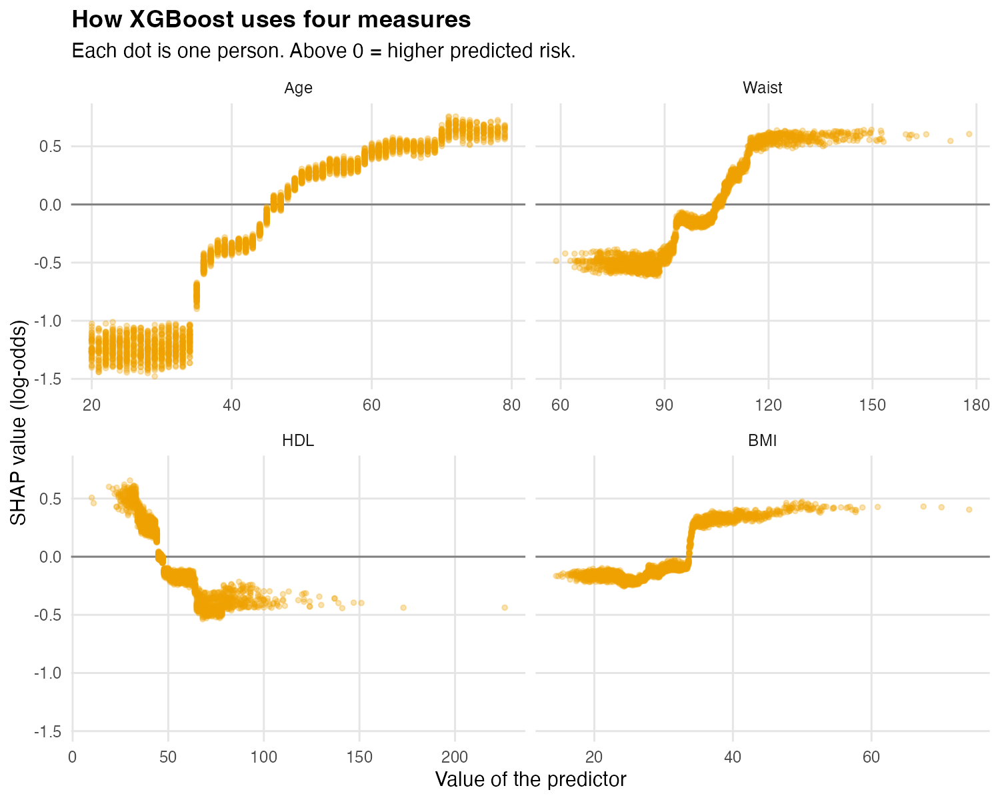

# How sure is the model? Predicting undiagnosed type 2 diabetes from routine health data

Tanvir Ahmed, MSc Statistical Data Analytics, Tampere University
November 2026

## 1. Background

Many people with type 2 diabetes do not know they have it. In NHANES, about one in four or five adults with diabetes has never been diagnosed. A simple risk model built from things a nurse can measure in a few minutes (age, waist, blood pressure, a cholesterol test) could help decide who should get an HbA1c test.

Machine learning papers often report only the AUC. For a screening tool that is not enough. I also wanted to know whether the predicted risks are correct in absolute terms (calibration), how uncertain the prediction is for one person, whether the model works equally well in different groups, and whether using it would lead to better testing decisions than testing everyone. These are the questions of this project. I kept the models simple on purpose.

## 2. Data

I used three cycles of NHANES, 2013-2014, 2015-2016 and 2017-2018. NHANES is a US survey with an interview, a physical exam and blood tests. The data log in `data/raw/README.md` lists every file and variable.

**Outcome.** Undiagnosed diabetes: HbA1c of 6.5% or higher, or fasting plasma glucose of 126 mg/dL or higher, in a person who has never been told by a doctor that they have diabetes. These are the standard diagnostic cut-offs (American Diabetes Association, 2024). Fasting glucose was only measured in the morning subsample, so for about half of the people the outcome is based on HbA1c alone.

**Predictors (14).** Age, sex, ethnicity, education, family income, BMI, waist circumference, systolic and diastolic blood pressure, total cholesterol, HDL cholesterol, smoking, physical activity and family history of diabetes.

**Sample.** I included adults aged 20-79 who were examined, not pregnant, not previously diagnosed with diabetes and had an HbA1c result. After removing 1,156 people with a missing predictor, 11,240 people were left and 561 of them (5.0%) had undiagnosed diabetes. Income was missing for 9%, so I kept "missing" as its own income group rather than dropping these people.

**Survey design.** NHANES oversamples some groups (for example Black, Hispanic and Asian Americans and older adults), so the sample is not a simple random sample of the US. With the survey weights, strata and PSUs, the estimated prevalence of undiagnosed diabetes among US adults without a diagnosis is 3.5% (95% CI 3.1-4.0), lower than the unweighted 5.0%. I fitted the prediction models without weights. The aim was to predict for individuals, not to estimate a population number. Even so, this means the absolute risks are tied to the NHANES sample mix (see limitations).

Table 1 (`output/table1.csv`) compares people with and without undiagnosed diabetes. People with diabetes were on average 10 years older (56 vs 46), had a larger waist (109 vs 98 cm), higher systolic blood pressure (133 vs 123 mmHg) and lower HDL (48 vs 54 mg/dL). They were less often physically active (38% vs 53%).

## 3. Methods

I split the data at random into a training set (50%, 281 cases), a calibration set (20%, 112 cases) and a test set (30%, 168 cases), keeping the share of cases the same in each. The training set was used to fit and tune the models. The calibration set was only used for conformal prediction. All results below come from the test set, which the models never saw.

**Models.** I compared four models:

1. Logistic regression with all 14 predictors as linear terms (the baseline).
2. LASSO logistic regression, with the penalty chosen by 5-fold cross-validation.
3. Random forest (500 trees). I tuned the number of variables per split and the minimum node size over a small grid with 5-fold cross-validation.
4. Gradient boosting with the `gbm` package (trees of depth 2, learning rate 0.01). The number of trees (879) was chosen by 5-fold cross-validation. I first planned to use XGBoost, but `gbm` does the same kind of boosting and was simpler to install.

**Discrimination and calibration.** AUC measures how well the model ranks people with diabetes above people without. Calibration checks whether a predicted 10% risk really means that about 10 in 100 such people have diabetes. I report the calibration intercept (0 is ideal; it shows if predictions are too high or too low on average) and the calibration slope (1 is ideal; a slope below 1 means the predictions are too extreme), as recommended by Van Calster et al. (2019). The Brier score is the mean squared difference between predicted risk and outcome. All 95% confidence intervals come from 1,000 bootstrap samples of the test set.

**Conformal prediction.** A predicted risk of 4% does not say how sure the model is. Conformal prediction (Vovk et al., 2005; Angelopoulos and Bates, 2021) turns a prediction into a set of possible answers, here {No}, {Yes} or {No, Yes}, which should contain the true answer for at least 90% of people. The method only assumes that the calibration and test people are exchangeable (drawn from the same population). It works on top of any model. I used the score 1 minus the predicted probability of the true class, found its 90% quantile in the calibration set, and put every class that scores below this quantile into the set. I tried the standard version (one quantile for everybody) and the class-conditional (Mondrian) version, which uses separate quantiles for people with and without diabetes.

**Fairness.** For sex, three age groups and five ethnic groups I computed the AUC, the ratio of observed to expected cases (O/E, where expected = sum of predicted risks; 1 is perfect calibration-in-the-large) and the sensitivity at a 5% risk threshold.

**Interpretation.** SHAP values show how much each predictor moves one person's prediction away from the average prediction (Lundberg and Lee, 2017). For logistic regression they have an exact formula, coefficient times (value minus mean). For the boosting model I estimated them by Monte Carlo sampling of feature orders (Strumbelj and Kononenko, 2014), with 100 samples per person and predictor, for 500 test-set people. As a check, the summed SHAP values correlated 0.996 with the model's own predictions.

**Decision curve analysis.** Suppose everyone with predicted risk above a threshold t gets an HbA1c test. The net benefit is (true positives - false positives x t/(1-t)) / n (Vickers and Elkin, 2006). The threshold works as an exchange rate: t = 5% means we accept 19 unnecessary tests to find one case. A model is useful at t if its net benefit is higher than both "test everyone" and "test no one".

Everything was done in R 4.3. `run_all.R` runs all steps and takes about two minutes.

## 4. Results

### 4.1 Discrimination and calibration

| Model | CV AUC (train) | Test AUC (95% CI) | Brier | Calibration intercept | Calibration slope (95% CI) |
|---|---|---|---|---|---|
| Logistic | 0.782 | 0.779 (0.747-0.808) | 0.046 | -0.01 | 0.88 (0.73-1.02) |
| LASSO | 0.785 | 0.778 (0.746-0.806) | 0.045 | -0.01 | 0.98 (0.82-1.14) |
| Random forest | 0.780 | 0.757 (0.723-0.788) | 0.046 | -0.03 | 0.93 (0.77-1.10) |
| Boosting | 0.787 | 0.773 (0.741-0.801) | 0.046 | 0.01 | 0.88 (0.76-1.01) |

All four models had a test AUC between 0.76 and 0.78. The two tree models were not better than plain logistic regression. The bootstrap difference from logistic regression was -0.001 (95% CI -0.005 to 0.003) for LASSO, -0.006 (-0.022 to 0.011) for boosting and -0.022 (-0.045 to 0.001) for random forest. With 14 mostly continuous predictors and little interaction between them, a flexible model has not much to add. This agrees with the review by Christodoulou et al. (2019), who found no average benefit of machine learning over logistic regression in clinical prediction models.

Calibration was good for all models. The intercepts were close to 0, so the average predicted risk (4.9-5.0%) matched the observed 5.0%. The slopes for logistic regression and boosting (0.88) were a little below 1, which means their highest risks are slightly too high and their lowest slightly too low. This is a sign of mild overfitting. LASSO shrinks the coefficients and had the best slope (0.98). The random forest curve is the most uneven, even though its slope is close to 1.

### 4.2 How sure is the model? Conformal prediction

The standard conformal method reached 90.1% coverage overall, exactly what it promises. But it reached it in a useless way: it covered 95% of people without diabetes and **0%** of people with diabetes. Because only 5% of people are cases, the method can meet the 90% target by always saying "No". For the logistic model, a person only got "Yes" in the set if the predicted risk was above 84%, and the highest predicted risk in the test set was 52%.

The class-conditional version fixed this. Coverage was 89.9% for people with diabetes and 89.3% for people without. In practice it splits people into three groups (logistic model):

| Prediction set | Predicted risk | People in test set | Of whom with diabetes |
|---|---|---|---|
| {No} | below 2.8% | 1,643 (49%) | 17 (1.0%) |
| {No, Yes}: uncertain | 2.8% to 11.4% | 1,326 (39%) | 93 (7.0%) |
| {Yes} | above 11.4% | 402 (12%) | 58 (14.4%) |

For four in ten people the honest answer is "the model cannot tell". I think this is a fair description of what routine measures can do; it is also a more useful output than a single risk number. Note that {Yes} does not mean "has diabetes": only 14% of people in that group had it. The guarantee is about coverage, not about how likely a set label is to be correct.

One more problem showed up when I looked at subgroups. The 90% guarantee holds on average over the whole population, not inside each group. For young adults (20-39) with diabetes, coverage was only 65% (23 cases), and for White adults with diabetes it was 77% (44 cases). For people aged 60-79 without diabetes it was 70%. The model gives older people higher risks, so older people without diabetes end up in the {No, Yes} or {Yes} sets more often.

### 4.3 Fairness

Discrimination differed by age and sex. The AUC was 0.85 at age 20-39 but only about 0.70 at ages 40-59 and 60-79. Inside an older age group, age itself (the strongest predictor) does not separate people much any more. The AUC was also higher for women (0.82) than for men (0.74). Between ethnic groups the AUCs were similar (0.74-0.78), with wide confidence intervals.

Calibration by group was acceptable for the logistic model: all O/E ratios had confidence intervals that included 1. The boosting model was different. It under-predicted risk for Asian Americans, with 63% more cases than expected (O/E 1.63, 95% CI 1.14-2.27). Asian Americans are known to develop diabetes at a lower BMI than other groups. Logistic regression handles this with one ethnicity coefficient (odds ratio 3.4 compared with White adults after adjusting for BMI and waist). The tree model with depth-2 trees seems to have learned the effect less well. For Black adults both models tended to over-predict (O/E 0.81 for logistic, 95% CI 0.57-1.07).

At a 5% threshold, the logistic model flagged 79% of Asian, 81% of Hispanic and 78% of Black adults with diabetes, but only 61% of White adults with diabetes and 48% of those aged 20-39. A single threshold therefore gives different sensitivity in different groups. A group-specific threshold would be one way to deal with this, though it raises its own fairness questions.

### 4.4 What drives the predictions? SHAP

Both models agreed on the most important predictors: age, waist, HDL cholesterol and ethnicity, followed by BMI and systolic blood pressure. This matches clinical knowledge. Central obesity, low HDL and high blood pressure are parts of the metabolic syndrome, and age, waist and BMI are also the main items in the Finnish FINDRISC score. Family history mattered surprisingly little (odds ratio 1.14, 95% CI 0.88-1.47, after adjusting for the other predictors). One reason may be that it is self-reported and overlaps with ethnicity and body size. Sex had almost no effect.

The dependence plots show the shapes the boosting model learned. Risk rose steadily with age from about 35 years. For waist and BMI, risk was flat up to about 95 cm and 30 kg/m2 and then went up. For HDL the effect was the reverse: risk increased below about 45 mg/dL and was flat above it. These thresholds look plausible. They also suggest that the logistic model could be improved by using splines for waist, BMI and HDL instead of straight lines.

### 4.5 Is the model useful for screening? Decision curve analysis

All four models had a higher net benefit than "test everyone" and "test no one" for thresholds between about 2% and 13%. The four curves were almost on top of each other. Logistic regression and LASSO were slightly higher between 5% and 10%. Above about 15% no strategy is better than testing no one.

Per 1,000 people (logistic model, test set):

| Risk threshold | Tested | Cases found | Cases missed | Share of cases found | Tests per case found |
|---|---|---|---|---|---|
| 2% | 607 | 46.6 | 3.3 | 94% | 13 |
| 3% | 496 | 44.2 | 5.6 | 89% | 11 |
| 5% | 335 | 37.1 | 12.8 | 74% | 9 |
| 10% | 147 | 19.6 | 30.3 | 39% | 7.5 |

For example, at a 3% threshold half of the people are tested and 89% of the hidden cases are found, compared with 20 tests per case if everyone is tested.

## 5. Discussion and limitations

A logistic regression with 14 routine measures predicted undiagnosed diabetes with an AUC of about 0.78 and good calibration. Random forest and boosting did not do better, and the boosting model was worse calibrated for Asian Americans. For this kind of data I would choose the simple model. It is easier to explain and check, and nothing was lost.

The more useful findings came from the checks beyond AUC. Standard conformal prediction gave the promised 90% coverage while missing every person with diabetes; with a rare outcome the class-conditional version is needed. Even then, coverage was not 90% inside subgroups. The AUC was much lower within older age groups, and the same risk threshold found a smaller share of cases among White and young adults.

Limitations:

- NHANES is cross-sectional. The model finds existing undiagnosed diabetes; it does not predict future diabetes.
- The outcome is based on one blood sample. In clinical practice a diagnosis needs a second test, so some "cases" would not be confirmed. Fasting glucose was only available for half of the people, so the outcome is less sensitive for the other half.
- The data are from the US. Ethnic groups, obesity levels and diabetes prevalence are different in Finland, so the model would need to be recalibrated (at least the intercept) before any use here.
- The models were fitted without survey weights, and the sample over-represents some groups. The predicted risks are about 1.4 times the weighted US prevalence (5.0% vs 3.5%), so absolute risks would be too high for the general US population.
- I dropped 1,156 people (9%) with missing predictors. Multiple imputation would be better.
- Smoking, physical activity and family history are self-reported.
- The test set has only 168 cases, so subgroup results (for example 6 cases in the "Other" group) are uncertain.

Next steps I would try: splines for waist, BMI and HDL; validation on a later NHANES cycle (2021-2023) to test transportability over time; and group-conditional conformal prediction, so that coverage is checked by age group and ethnicity and not only by outcome.

## References

American Diabetes Association Professional Practice Committee (2024). 2. Diagnosis and classification of diabetes: Standards of Care in Diabetes-2024. *Diabetes Care*, 47(Suppl. 1), S20-S42.

Angelopoulos, A. N. and Bates, S. (2021). A gentle introduction to conformal prediction and distribution-free uncertainty quantification. arXiv:2107.07511.

Christodoulou, E., Ma, J., Collins, G. S., Steyerberg, E. W., Verbakel, J. Y. and Van Calster, B. (2019). A systematic review shows no performance benefit of machine learning over logistic regression for clinical prediction models. *Journal of Clinical Epidemiology*, 110, 12-22.

Lundberg, S. M. and Lee, S.-I. (2017). A unified approach to interpreting model predictions. *Advances in Neural Information Processing Systems*, 30, 4765-4774.

Strumbelj, E. and Kononenko, I. (2014). Explaining prediction models and individual predictions with feature contributions. *Knowledge and Information Systems*, 41(3), 647-665.

Van Calster, B., McLernon, D. J., van Smeden, M., Wynants, L. and Steyerberg, E. W. (2019). Calibration: the Achilles heel of predictive analytics. *BMC Medicine*, 17, 230.

Vickers, A. J. and Elkin, E. B. (2006). Decision curve analysis: a novel method for evaluating prediction models. *Medical Decision Making*, 26(6), 565-574.

Vovk, V., Gammerman, A. and Shafer, G. (2005). *Algorithmic Learning in a Random World*. Springer, New York.

Data: Centers for Disease Control and Prevention, National Center for Health Statistics. National Health and Nutrition Examination Survey data, 2013-2018. https://wwwn.cdc.gov/nchs/nhanes/
