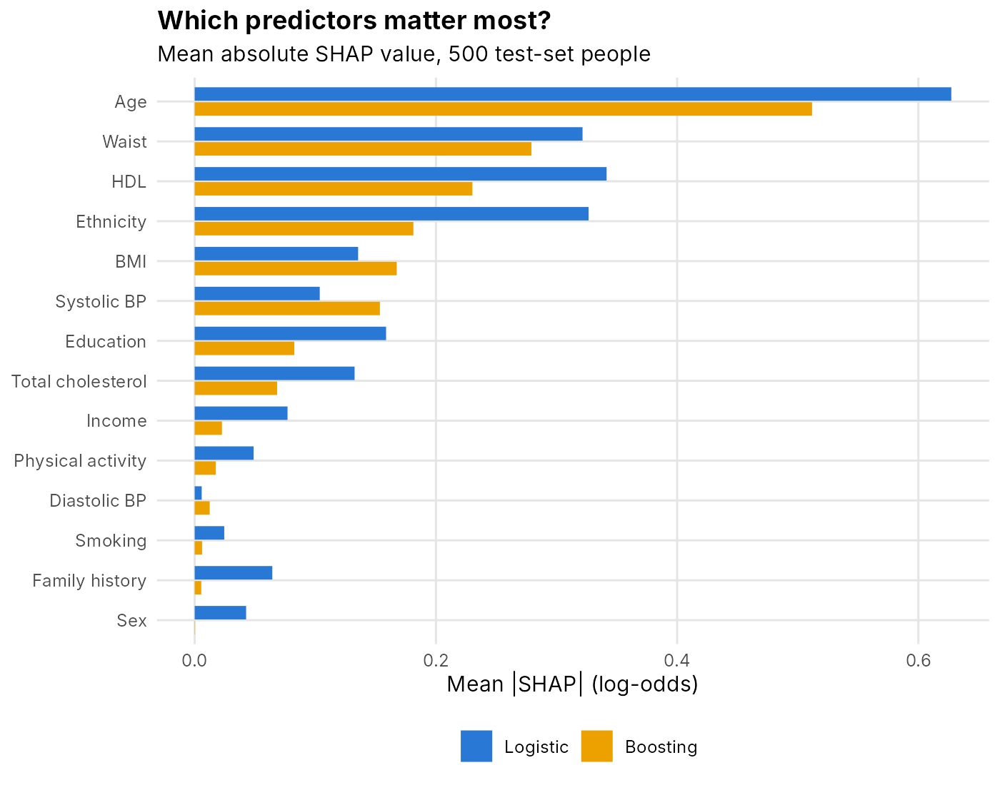
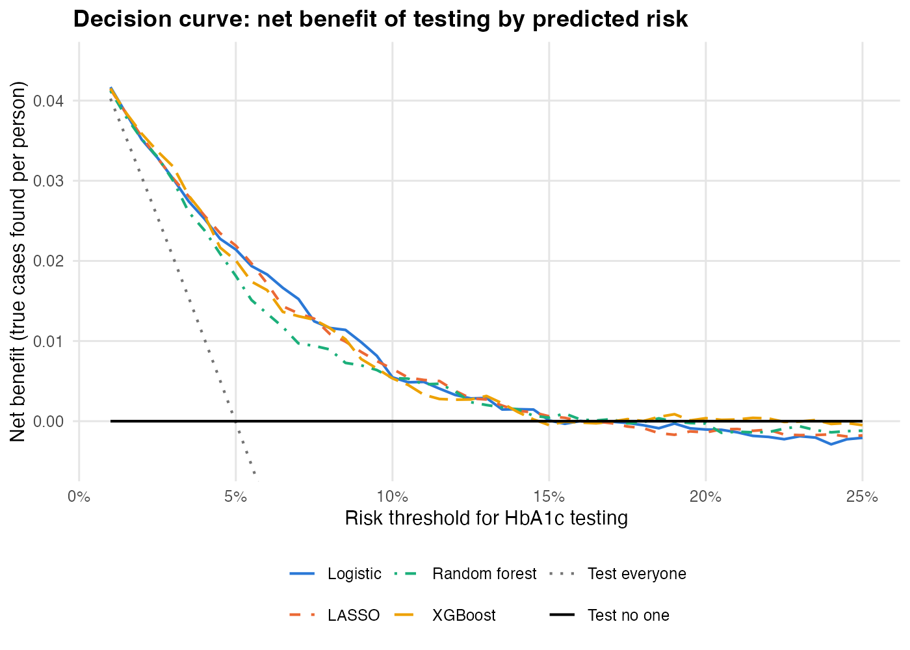

# How sure is the model? Predicting undiagnosed type 2 diabetes with simple machine learning

Tanvir Ahmed, MSc Statistical Data Analytics, Tampere University, November 2026

## Why this project

Many people with type 2 diabetes don't know they have it. I wanted to see if a few simple measures (age, waist, blood pressure, cholesterol) can find these people. I also wanted to learn how to check a prediction model properly, not only by its accuracy: Are the predicted risks correct? How sure is the model for one person? Does it work equally well for everyone?

## Data

I used NHANES 2013-2018, a public US health survey with interviews, physical exams and blood tests. I kept adults aged 20-79 without a diabetes diagnosis and with no missing values: **11,240 people**. Of these, **561 (5.0%)** had undiagnosed diabetes, meaning HbA1c ≥ 6.5% or fasting glucose ≥ 126 mg/dL.

I used 14 predictors: age, sex, ethnicity, education, income, BMI, waist, systolic and diastolic blood pressure, total and HDL cholesterol, smoking, physical activity and family history of diabetes. The cleaning steps are in [data/raw/README.md](../data/raw/README.md).

## What I did

1. Split the data into training (50%), calibration (20%) and test (30%) sets.
2. Fitted four models on the training set: logistic regression, LASSO, random forest and XGBoost.
3. Checked them on the test set: AUC, calibration and Brier score, with bootstrap confidence intervals.
4. Used conformal prediction to give each person a set of possible answers instead of just a number.
5. Compared performance by sex, age group and ethnicity.
6. Used SHAP values to see which predictors drive the predictions.
7. Used decision curve analysis to ask if the model would help decide who should get a blood test.

## Results

### The models

| Model | Test AUC (95% CI) | Calibration slope |
|---|---|---|
| Logistic regression | 0.78 (0.75-0.81) | 0.88 |
| LASSO | 0.78 (0.75-0.81) | 1.00 |
| Random forest | 0.75 (0.72-0.79) | 0.91 |
| XGBoost | 0.78 (0.75-0.80) | 0.98 |

All models were about equally good. XGBoost had the best cross-validated AUC on the training data (0.79), but on the test set it did not beat simple logistic regression. Calibration was also good: the average predicted risk matched the real 5%, and a slope close to 1 means the risks are not too extreme.

### How sure is the model?

Conformal prediction gives each person a set: {No}, {Yes} or {No, Yes}. The set should contain the true answer for 90% of people.

The standard method reached 90% overall, but it did this by saying "No" to everybody. It missed **all** people with diabetes. The reason is that the outcome is rare, so "No" is right 95% of the time. The class-conditional version fixed this and gave about 90% for both groups. With the logistic model, 49% of people got {No}, 12% got {Yes}, and **39% got {No, Yes}**, which means the model can't tell. I found this the most interesting result.

### Does it work for everyone?

The AUC was 0.85 for ages 20-39 but only about 0.70 for older people. Logistic regression was well calibrated in all groups. XGBoost was not. It predicted too few cases for Asian Americans (66% more real cases than predicted) and too many for White adults (26% fewer real cases than predicted). The SHAP results below suggest why: XGBoost used ethnicity much less than logistic regression did.

### What drives the predictions?

Age, waist and HDL cholesterol were the most important predictors in both models. This makes sense, because belly fat and low HDL are known risk factors for diabetes. Ethnicity was important for logistic regression but not for XGBoost, which used blood pressure and BMI more.

### Would it help screening?

All models were better than testing everyone when the risk threshold was between about 2% and 13%. For example, if we test only people with a predicted risk above 3%, we test half of the people and still find 89% of the hidden cases.

## What I learned and limitations

- A simple logistic regression was as good as XGBoost here, and it is easier to explain.
- A good AUC is not enough. Conformal prediction showed that the model is unsure for many people, and the subgroup checks showed that it works better for some groups than others.
- The data are from the US and cross-sectional, so the model finds existing diabetes. It does not predict future diabetes, and it would need recalibration before use in Finland.
- The outcome is based on one blood test, and some predictors (smoking, activity, family history) are self-reported.
- I did not use the NHANES survey weights in the models, and I dropped people with missing data.
